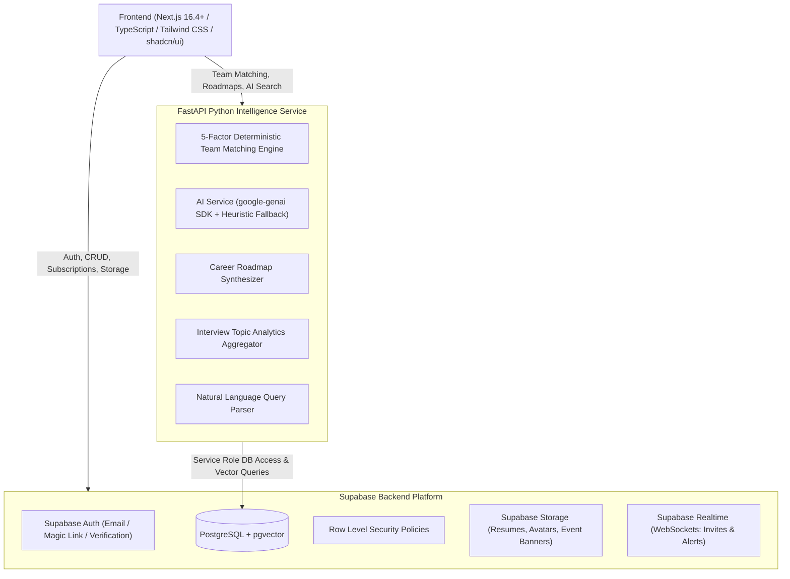
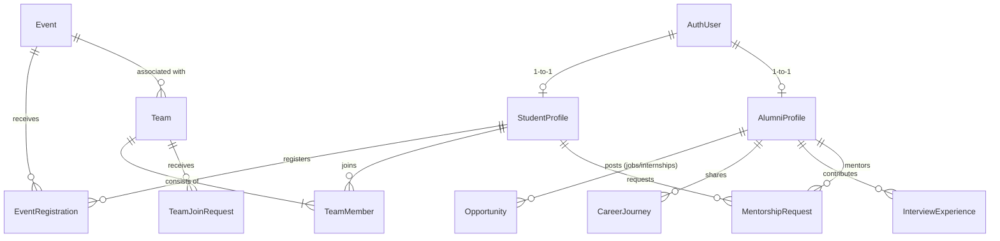

# Implementation Plan - College Career & Opportunity Network (SAN)

Build a college-focused career and opportunity web application that connects students, alumni, opportunities, events, and student teams into an active career intelligence ecosystem.

---

## User Review Required

> [!IMPORTANT]
> **Supabase Configuration & Credentials**:
> The backend infrastructure is now strictly centered on **Supabase** (PostgreSQL with `pgvector`, Supabase Auth, Supabase Storage, and Supabase Realtime with Row Level Security).
> - Frontend communicates directly with Supabase for Auth, CRUD, Storage, and Realtime subscriptions.
> - FastAPI acts as the dedicated **Intelligence & Computation Microservice** (5-Factor Deterministic Team Matching, Gemini AI roadmap synthesis, interview topic analytics, and natural language search).
> - To run against Supabase, you will provide `NEXT_PUBLIC_SUPABASE_URL`, `NEXT_PUBLIC_SUPABASE_ANON_KEY`, and `SUPABASE_SERVICE_ROLE_KEY` in `.env`. Complete SQL migration scripts (`schema.sql` and `rls_policies.sql`) will be provided to set up tables, RLS policies, and vector extensions in one run.

> [!NOTE]
> **Demo Data Integrity Notice**:
> All pre-populated alumni profiles and opportunities are explicitly labeled as **[Demo / Fictional Profile]** to guarantee compliance with ethical data standards and avoid presenting simulated employment records as real individuals.

---

## Final System Architecture

---

## Data Model & Database Schema (Supabase PostgreSQL + pgvector)

### Corrected Cardinality & Entity Separation
1. **User & Profiles (1-to-1)**:
   - Each `users` record (managed by Supabase Auth) maps to either one `student_profiles` or one `alumni_profiles` row (`user_id` as primary key and foreign key referencing `auth.users.id`).
2. **Opportunities vs. Events**:
   - **`opportunities`**: Jobs and internships exclusively (company, role, stipend/salary, eligibility, deadline, verified badge).
   - **`events`**: Hackathons, technical competitions, non-technical events, workshops, paper presentations, symposiums.
   - **`event_registrations`**: Tracks student registrations for events (`event_id`, `student_id`, `status`, `registered_at`).
3. **Teams & Dynamic Member Calculation**:
   - `teams` does **not** store a redundant `current_members` counter. Member count and roles are computed dynamically via `COUNT(team_members.id)` and `team_members` join.

### Table Specifications:
- **`student_profiles`**: `user_id` (PK), `full_name`, `department`, `current_year` (1, 2, 3, 4), `expected_graduation_year`, `skills` (TEXT[]), `interests` (TEXT[]), `career_goals` (TEXT), `bio`, `github_url`, `linkedin_url`, `portfolio_url`, `is_looking_for_team` (BOOL), `preferred_roles` (TEXT[]), `is_verified` (BOOL).
- **`alumni_profiles`**: `user_id` (PK), `full_name`, `department`, `graduation_year`, `current_company`, `current_role`, `industry`, `location`, `skills` (TEXT[]), `bio`, `linkedin_url`, `is_available_for_mentorship` (BOOL), `mentorship_categories` (TEXT[]), `years_of_experience` (INT), `is_verified` (BOOL), `is_demo` (BOOL).
- **`opportunities`** *(Jobs & Internships)*: `id` (UUID), `title`, `company`, `type` (`job`, `internship`), `location_type` (`remote`, `on-site`, `hybrid`), `location`, `stipend_salary`, `description`, `skills_required` (TEXT[]), `eligibility`, `application_link`, `deadline` (TIMESTAMPTZ), `posted_by` (FK $\rightarrow$ `alumni_profiles.user_id`), `is_verified` (BOOL), `is_approved` (BOOL), `is_demo` (BOOL), `created_at`.
- **`events`** *(Competitions, Hackathons, Workshops)*: `id` (UUID), `title`, `organizer`, `category` (`hackathon`, `coding_contest`, `workshop`, `paper_presentation`, `symposium`, `other`), `description`, `mode` (`online`, `offline`, `hybrid`), `venue`, `event_date` (TIMESTAMPTZ), `registration_deadline` (TIMESTAMPTZ), `team_min_size` (INT), `team_max_size` (INT), `registration_link`, `created_at`.
- **`event_registrations`**: `id` (UUID), `event_id` (FK), `student_id` (FK), `status` (`registered`, `attended`, `cancelled`), `registered_at`.
- **`teams`**: `id` (UUID), `event_id` (FK $\rightarrow$ `events.id`, nullable for open teams), `title`, `description`, `creator_id` (FK $\rightarrow$ `student_profiles.user_id`), `target_team_size` (INT), `needed_roles` (TEXT[]), `needed_skills` (TEXT[]), `deadline` (TIMESTAMPTZ), `status` (`open`, `full`, `closed`), `created_at`.
- **`team_members`**: `id` (UUID), `team_id` (FK), `student_id` (FK), `role_in_team`, `joined_at`.
- **`team_join_requests`**: `id` (UUID), `team_id` (FK), `applicant_id` (FK), `message`, `status` (`pending`, `accepted`, `rejected`), `created_at`.
- **`career_journeys`**: `id` (UUID), `alumni_id` (FK), `stages` (JSONB: chronological steps like College $\rightarrow$ Skills $\rightarrow$ Projects $\rightarrow$ Internships $\rightarrow$ Job Applications $\rightarrow$ Interview Rounds $\rightarrow$ First Job $\rightarrow$ Current Role), `mistakes_made` (TEXT), `lessons_learned` (TEXT), `advice_for_juniors` (TEXT), `created_at`.
- **`interview_experiences`**: `id` (UUID), `alumni_id` (FK), `company`, `role`, `year`, `department`, `difficulty` (`easy`, `medium`, `hard`), `outcome` (`offered`, `rejected`), `rounds` (JSONB: round names, questions, topics, advice), `topics_covered` (TEXT[]: DSA, OOP, DBMS, OS, System Design, etc.), `preparation_resources` (TEXT), `created_at`.
- **`mentorship_requests`**: `id` (UUID), `student_id` (FK), `alumni_id` (FK), `category`, `message`, `status` (`pending`, `accepted`, `declined`, `completed`), `created_at`.
- **`saved_opportunities`**: `id` (UUID), `user_id` (FK), `opportunity_id` (FK), `created_at`.

---

## Deterministic Matching Engine vs. AI Capabilities

To ensure 100% predictability, transparency, and explainability, **teammate matching is completely separated from generative AI**:

### 1. Deterministic 5-Factor Team Matching Engine (Pure Algorithmic)
The matching score uses fixed arithmetic:

$$\text{Total Score} = 0.30 \cdot S_{\text{skills}} + 0.25 \cdot S_{\text{interests}} + 0.20 \cdot S_{\text{event}} + 0.15 \cdot S_{\text{experience}} + 0.10 \cdot S_{\text{availability}}$$

- **Skill Complementarity ($30\%$)**: Calculates the overlap between candidate skills and the **team's unfilled needed skills** (not overlapping with skills current members already bring).
- **Interest Compatibility ($25\%$)**: Jaccard similarity between candidate interests and event/team domain tags.
- **Event Compatibility ($20\%$)**: Checks if the student is registered for the same event in `event_registrations` (or has participated in this event type).
- **Experience Compatibility ($15\%$)**: Normalized score comparing student academic year / project count with team target level.
- **Availability ($10\%$)**: Value of `is_looking_for_team` flag and deadline viability.

**Explanation Generation**:
Rules generate transparent explanation bullets without LLM hallucination:
> - *"+30% Skill Complementarity: Candidate brings Frontend (React) and UI/UX skills that your current team lacks."*
> - *"+20% Event Match: Candidate is already registered for this Hackathon."*
> - *"+25% Shared Interest: You both focus on Healthcare & AI."*

### 2. AI Capabilities (`google-genai` SDK + Heuristic Fallback)
The AI microservice handles generative, semantic, and analytical tasks:
- **Career Roadmap Synthesis**: Analyzes structured alumni career journeys for a target career goal (e.g., "Cloud Architect" or "Full-Stack Engineer") and creates a phased milestone roadmap (Fundamentals $\rightarrow$ Core CS $\rightarrow$ Practical Projects $\rightarrow$ Internships $\rightarrow$ Interview Rounds).
- **Natural Language Query Parser**: Parses free-form queries (e.g., *"Find AI hackathons suitable for 2nd year students"* or *"Cybersecurity alumni in Chennai"*) into structured filters (`category=hackathon`, `skills=['AI']`, `eligibility='2nd year'`).
- **Interview Topic Aggregator**: Statistical aggregation of high-frequency interview topics per company/role (DSA, OOP, DBMS, OS, System Design).
- **Resilient Fallback**: If the Gemini API key is unset or external calls time out, a rule-based statistical pattern extractor immediately handles requests without error.

---

## Proposed Changes Grouped by Component

### Database & Backend Microservice

#### [NEW] `supabase/migrations/001_schema.sql`
- Complete DDL for all tables, indexes, and pgvector extension.
- Foreign key constraints referencing `auth.users`.

#### [NEW] `supabase/migrations/002_rls.sql`
- Row Level Security (RLS) policies for:
  - Public read for verified opportunities, events, and approved journeys.
  - User-specific update permissions (only profile owner can update profile).
  - Admin override policies for moderation and verification.

#### [NEW] `supabase/seed.sql`
- High-fidelity **demo dataset** for Saveetha Engineering College (SAN).
- Explicit fictional tags on all profiles (`is_demo = true`, Full Name: *"Alex Kumar [Demo Profile]"*, etc.).
- Realistic companies (Amazon, Zoho, Freshworks, TCS) and hackathons (Smart India Hackathon, internal college symposium).

#### [NEW] `backend/requirements.txt` & `backend/app/main.py`
- FastAPI app exposing compute endpoints:
  - `POST /api/matching/team-recommendations`
  - `POST /api/ai/career-roadmap`
  - `POST /api/ai/nl-search`
  - `GET /api/analytics/interview-prep/{company}`
- Dependencies: `fastapi`, `uvicorn`, `pydantic`, `google-genai`, `supabase`, `python-dotenv`.

#### [NEW] `backend/app/services/matching_service.py`
- Pure Python deterministic 5-factor scoring engine with bullet-point reason generator.

#### [NEW] `backend/app/services/ai_service.py`
- Google GenAI SDK integration (`from google import genai`) with prompt templates for roadmap generation, NL search translation, and heuristic pattern fallback.

#### [NEW] `backend/app/services/prep_analyzer.py`
- Statistical aggregation engine computing topic percentage bars (DSA, OOP, DBMS, OS, System Design).

---

### Frontend (Next.js 16.4+ / TypeScript / Tailwind CSS / Supabase)

#### [NEW] `frontend/package.json`
- Next.js 16.4+, React 19, TypeScript, Tailwind CSS, Lucide React, `@supabase/supabase-js`, `@supabase/ssr`.

#### [NEW] `frontend/src/lib/supabase/client.ts` & `server.ts`
- Browser and server client instances utilizing `@supabase/ssr` with cookie session handling.

#### [NEW] `frontend/src/lib/config.ts`
- College configuration: `COLLEGE_NAME = "Saveetha Engineering College"`, `COLLEGE_EMAIL_DOMAIN = "saveetha.ac.in"`. Supports unverified registration with verification banner.

#### [NEW] `frontend/src/components/layout/Navbar.tsx`, `Sidebar.tsx`, `Footer.tsx`
- Responsive navigation with Saveetha Alumni Network branding, active user role badge, notification popover, and direct search.

#### [NEW] `frontend/src/components/matching/MatchExplanationModal.tsx` & `MatchBadge.tsx`
- Interactive visual breakdown displaying the 5-factor percentage scores and clear reasons.

#### [NEW] `frontend/src/components/roadmap/CareerRoadmapView.tsx`
- Visual milestone path synthesized from alumni career journeys.

#### [NEW] `frontend/src/components/prep/TopicFrequencyChart.tsx`
- Horizontal frequency bars for company-specific interview preparation topics.

#### [NEW] `frontend/src/components/journey/CareerJourneyTimeline.tsx`
- Chronological timeline component (College $\rightarrow$ Skills $\rightarrow$ Projects $\rightarrow$ Internships $\rightarrow$ Rounds $\rightarrow$ Role) with advice and lessons learned.

#### [NEW] App Router Pages (`frontend/src/app`):
- `page.tsx`: Modern landing page showcasing the 4 core pillars with quick login/demo buttons.
- `dashboard/page.tsx`: Role-aware personalized feed with recommendations, upcoming deadlines, and recent alumni posts.
- `alumni/page.tsx` & `alumni/[id]/page.tsx`: Alumni directory with multi-filters and profile page showing career journey & interview experiences.
- `opportunities/page.tsx` & `opportunities/[id]/page.tsx`: Jobs and internships board with bookmarking and direct application link.
- `events/page.tsx` & `events/[id]/page.tsx`: Competitions, hackathons, and workshops with registration and "Find Team" button.
- `teams/page.tsx`, `teams/create/page.tsx`, `teams/[id]/page.tsx`: Team builder with teammate recommendations drawer and join requests.
- `experiences/interviews/page.tsx`: Searchable interview experience database with topic charts.
- `experiences/journeys/page.tsx` & `experiences/share/page.tsx`: Career journey timeline browser and submission flow.
- `roadmap/page.tsx`: Goal-oriented roadmap generator based on alumni data.
- `mentorship/page.tsx`: Mentorship directory with category filtering and request modal.
- `admin/page.tsx`: Admin dashboard with verification queues (`Verify Student`, `Verify Alumni`, `Verify Opportunity`) and platform health stats.

---

## Verification Plan

### Automated Tests
1. **FastAPI Unit Tests (`pytest`)**:
   - `test_matching_service.py`: Verify deterministic 5-factor scoring formula math, edge cases (0% and 100%), and explanation accuracy.
   - `test_ai_service.py`: Verify Gemini AI response parsing and seamless fallback behavior when API key is missing.
   - `test_prep_analyzer.py`: Verify frequency calculation and topic distributions across mock interview experiences.
2. **Frontend Build & Typecheck**:
   - Run `npm run build` or `npx tsc --noEmit` on the Next.js 16.4+ app to verify complete type safety.

### Manual Verification
1. **Student Flow**:
   - Sign in as student user.
   - Browse events $\rightarrow$ register for Hackathon $\rightarrow$ click "Create Team Request" for Frontend + UI/UX roles.
   - Open Recommended Teammates $\rightarrow$ verify 5-factor match score breakdown and reasons.
   - Send join invitation $\rightarrow$ verify invite status update.
2. **Alumni Flow**:
   - Sign in as alumni user.
   - View own Career Journey timeline and interview contributions.
   - Post an internship opportunity $\rightarrow$ verify it appears in Opportunities with pending or verified status.
   - Toggle mentorship availability $\rightarrow$ check mentorship request inbox.
3. **Admin Flow**:
   - Sign in as admin user $\rightarrow$ navigate to `/admin`.
   - Review pending verification for students and newly submitted opportunities $\rightarrow$ click approve.
   - Verify `✓ Verified` badge displays on the public board.
